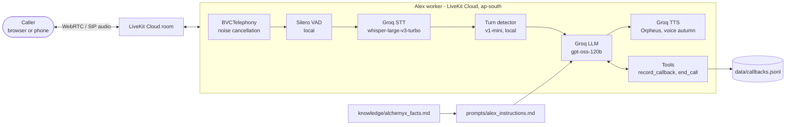
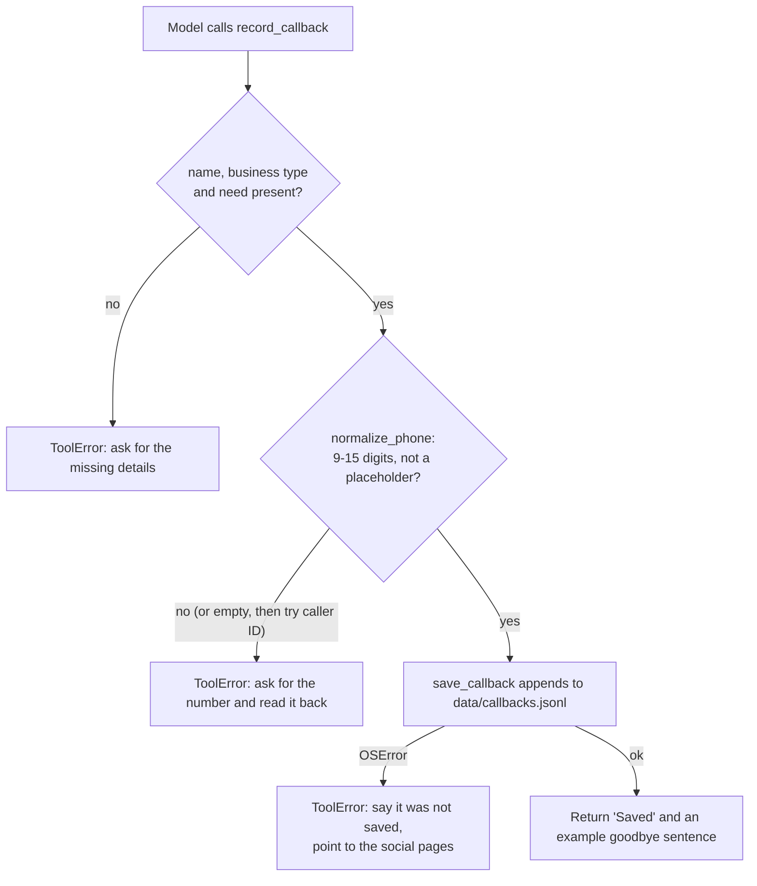

# Architecture

Alex is the AI phone receptionist for AlchemyX Global. It is one LiveKit Agents worker
(`agent.py`) that joins a LiveKit room when a call comes in, listens to the caller, and answers
using only the company fact sheet. It can also take a callback request and end the call.

## Overview



All three model calls (STT, LLM and TTS) go to Groq with one `GROQ_API_KEY`. Voice activity
detection and turn detection run inside the worker, so they cost no LiveKit Inference credits.

## Components

| Component | Where | What it does |
|---|---|---|
| Worker | `agent.py` | Registers with LiveKit Cloud as `alchemyx-alex`, starts one `AgentSession` per call |
| `Alex` agent class | `agent.py` | Holds the instructions and the two tools |
| Instructions | `prompts/alex_instructions.md` | Persona, speaking rules, strict rules, call ending. `{knowledge}` is the placeholder for the facts |
| Fact sheet | `knowledge/alchemyx_facts.md` | The only facts Alex may state. Numbers are written in words so the model copies words, not digits |
| Callback store | `data/callbacks.jsonl` | One JSON line per saved callback request (not in git) |
| Tests | `tests/test_alex.py` | The 30-question sheet as automated tests, plus tests for callbacks and call ending |
| Manual test sheet | `tests/test_sheet.md` | The same questions for manual rounds, and the round log |
| Container | `Dockerfile`, `.dockerignore` | Python 3.12 image; model files are downloaded at build time |
| Deployment binding | `livekit.toml` | Binds this folder to LiveKit Cloud agent `CA_PB2uQC44fnHm` |

## The voice pipeline

| Stage | Choice | Notes |
|---|---|---|
| Noise cancellation | `noise_cancellation.BVCTelephony()` | Tuned for phone audio |
| Voice activity detection | `silero.VAD` | Local; detects when someone is speaking |
| Speech to text | `groq.STT(model="whisper-large-v3-turbo")` | English |
| Turn detection | `inference.TurnDetector(version="v1-mini")` | Pinned to the local model (see decisions) |
| LLM | `groq.LLM(model="openai/gpt-oss-120b", reasoning_effort="low")` | Built by `build_llm()`, which the tests reuse |
| Text to speech | `groq.TTS()` (Orpheus `canopylabs/orpheus-v1-english`) | English only; terms accepted in the Groq console |

## Lifecycle of a call

1. **Dispatch.** The worker has an `agent_name`, so LiveKit sends it only to rooms that ask
   for `alchemyx-alex` by name: the Agents Playground/console, a token, the API, or a SIP
   dispatch rule.
2. **Start.** `entrypoint()` creates `Alex()` and the `AgentSession`, then starts the session
   in the room with telephony noise cancellation.
3. **Caller ID.** `find_caller_number()` looks for a `sip.phoneNumber` attribute on the remote
   participants. If one is found (a phone call), the instructions are rebuilt so Alex reads
   that number back for confirmation. Otherwise, as in a browser call, Alex asks for a number.
4. **Greeting.** `session.say(GREETING)` speaks a fixed greeting with no LLM call, so the
   first words are instant and always say "AlchemyX Global".
5. **Conversation.** Each caller turn goes through STT → turn detector → LLM → TTS. The
   caller can interrupt Alex mid-sentence.
6. **Callback (optional).** When Alex has the caller's name, business type, need and a
   confirmed number, it calls `record_callback`.
7. **End.** When the caller says goodbye, the model calls `end_call`. The tool returns
   `END_INSTRUCTIONS`, so Alex's last words repeat any callback back, thank the caller and
   say goodbye. The room is then deleted, which also hangs up a phone caller.

## Prompt assembly

`build_instructions(caller_number)` runs once per call (twice if a caller number is found):

```
prompts/alex_instructions.md
  with {knowledge} replaced by knowledge/alchemyx_facts.md   (str.replace, not str.format)
+ a CALLER section: "read back <number>" or "ask for the best number"
```

The whole fact sheet goes into the system prompt. There is no retrieval step. The fact sheet
is about forty lines, so this is cheaper and more reliable than searching it.

## Tools

### `record_callback(name, business_type, need, phone_number)`

The prompt tells the model when to save. The code checks that the request is complete.



- An empty `phone_number` falls back to the SIP caller ID. A number the model gives that
  fails the check does **not** fall back, because that usually means the model guessed one.
- Every `ToolError` message tells the model what to say next, so a failure never ends in
  silence or a vague apology.
- A saved request is also logged (`callback saved: {...}`), which is the only way to see it
  for calls handled in LiveKit Cloud. See the limitations.

### `end_call` (LiveKit `EndCallTool`, beta)

Configured with `end_instructions=END_INSTRUCTIONS`, `delete_room=True` and
`ignore_on_enter=True`. Its `extra_description` also covers "thanks, bye" and tells the model
not to end the call when the caller says "hold on" or says thanks but is still asking questions.

## Deployment

| Item | Value |
|---|---|
| Host | LiveKit Cloud, region `ap-south` (Mumbai) |
| Agent | `CA_PB2uQC44fnHm`, registered as `alchemyx-alex` |
| Project | `voice-agent-z73y1dl4` |
| Secrets | `GROQ_API_KEY` stored as a LiveKit Cloud secret; the LiveKit credentials are injected by the platform |
| Image | `Dockerfile`: Python 3.12, `pip install -r requirements.txt`, `download-files`, `CMD python agent.py start` |
| Excluded from image | `.env.*`, `tests/`, `.venv/`, `data/`, `KMS/`, `docs/`, `teaser/`, `*.mp3` |

Deploy and check a release (`lk` is not on PATH; see the README for its location):

```powershell
lk agent deploy --yes
lk agent status
lk agent logs
```

Local runs use `.env.local` and `run.bat` (`run` for dev mode, `run console` for the terminal mic).

## Testing

`pytest` with `pytest-asyncio`, run in text mode with no audio:

- **Sheet questions.** Each one checks the structure (a single message, no tool call), the
  phone style (at most two sentences, no digits, no markdown), and an LLM judge
  (`gpt-oss-20b`, which has the full fact sheet) for correctness and no invented facts.
- **Code-only tests:** `normalize_phone` and the incomplete-request guard.
- **Multi-turn tests:**
  - a callback is saved and repeated at goodbye;
  - a plain goodbye ends the call;
  - "hold on" does not end the call;
  - a failed save is admitted to the caller.

  `save_callback` is monkeypatched, so the real validation in `record_callback` still runs.
  `end_call` is mocked.

The tests call the real Groq models, so they share the free-tier quota with live calls.
